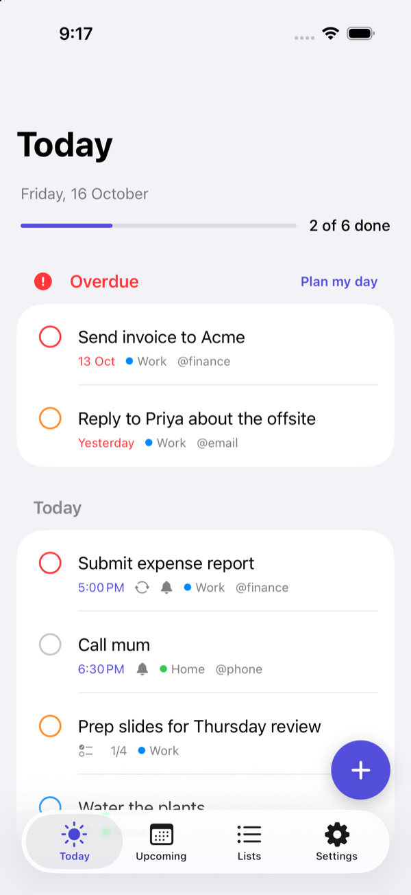
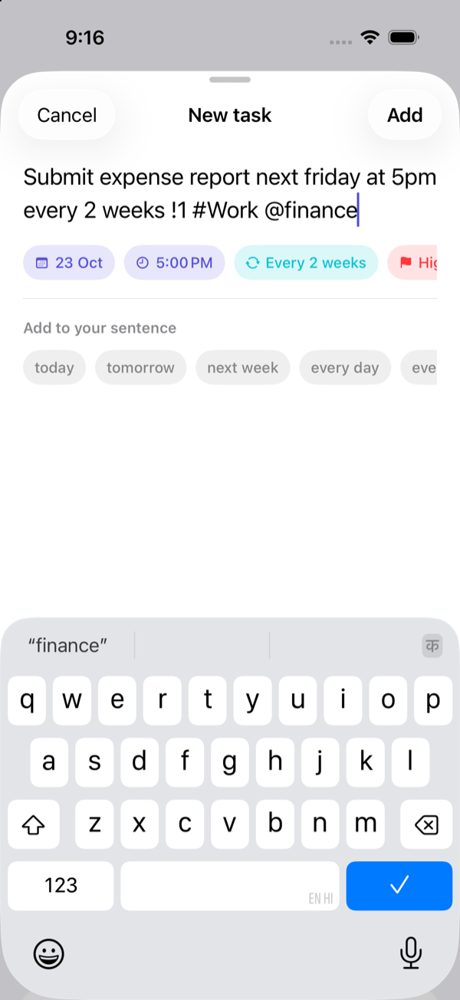
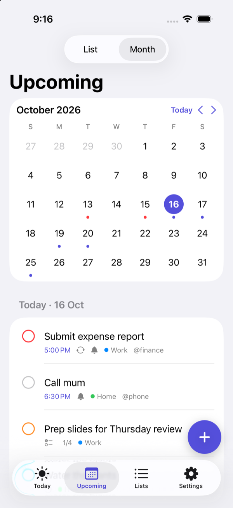
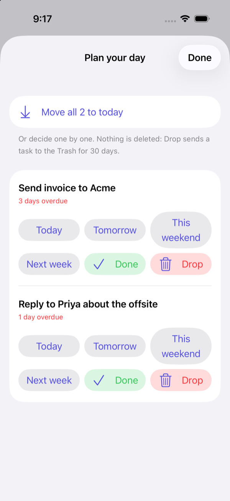
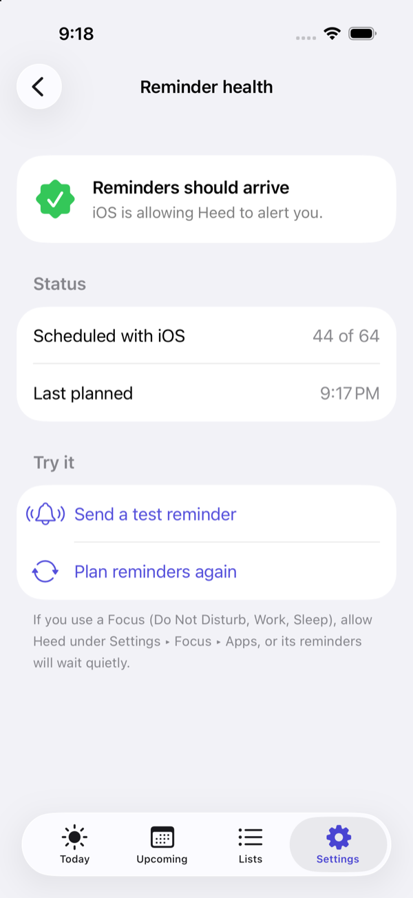
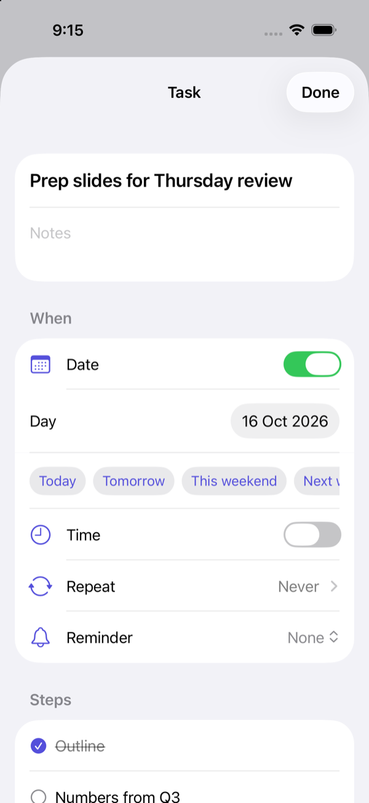
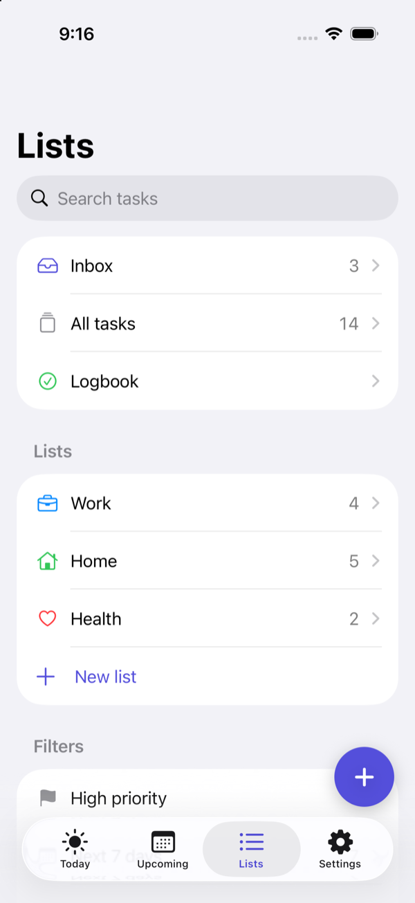
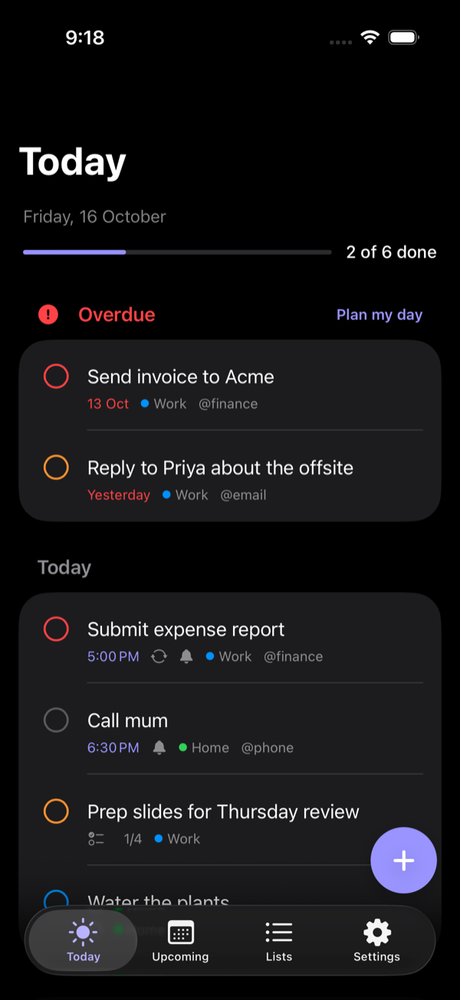
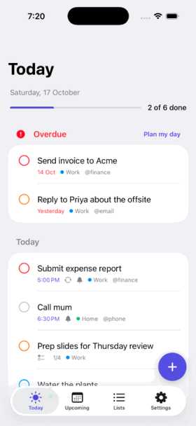

# Heed

A to-do list for iPhone you can trust: reminders that actually arrive, tasks that don't disappear, no account, no
subscription. Type a sentence ("call mum friday 6pm every month !1 #family"), see what Heed understood, press return.

<table>
  <tr>
    <td></td>
    <td></td>
    <td></td>
    <td></td>
  </tr>
  <tr>
    <td></td>
    <td></td>
    <td></td>
    <td></td>
  </tr>
</table>

## Demo



Complete a task, quick-add a sentence ("Call the dentist next friday at 3pm every month !1" becomes a dated, repeating, high-priority task), then Upcoming and Lists. Recorded on the iPhone 17 Pro simulator with demo data. [Full-quality video (MP4)](docs/demo.mp4)

## Why it exists

Before writing any code I looked at the five biggest to-do apps on the App Store (Todoist, TickTick, Any.do,
Microsoft To Do, Things 3): their ratings, sizes and prices from Apple's public listing, and the latest 50 reviews of
each. The same complaints kept coming back, and each one became a design rule here.

| What users complain about (App Store reviews, Oct 2026) | What Heed does about it |
| --- | --- |
| Tasks lost: "deleted all my tasks", items vanishing from a project, items falling out of a list when moved | Every change goes through one code path with **Undo**. Deleting moves a task to the **Trash for 30 days**. A **backup** is written every day (last 14 kept, visible in the Files app) and can be exported or restored any time. Restoring never overwrites newer edits. |
| Reminders that don't fire, vanish, or open to nothing; repeating tasks that drift or shift time | One tested **reminder planner** decides what iOS should hold, and a **Reminder health** screen says why something might not arrive, with a test button. Repeating tasks use a tested recurrence engine (see below). |
| Paywalls on the month view, filters, project counts; confusing free-trial billing | No account, no ads, no subscription. The month calendar, saved filters, unlimited lists and quick add are all free. |
| Crashes and blank widgets after new iOS releases | Plain SwiftUI and SwiftData, no third-party code. If the data store can't open, Heed shows a message and leaves your data alone instead of crashing or overwriting it. Interactive widgets use App Intents. |
| 124–385 MB downloads | A native app with no dependencies: about 8 MB in a Debug build for the simulator. |
| Unfinished tasks pile up as a red list | **Plan my day**: go through what slipped with one tap each (today, tomorrow, weekend, next week, done, drop). |

## Features

- **Quick add** with on-device natural language: dates, times, repeat rules, priority, `#list`, `@tag`. A live preview
  shows what was understood. See the cheat sheet below.
- **Today** with overdue tasks, a progress bar, and everything done so far (repeating tasks count as done too).
- **Upcoming** as a grouped list or a **month calendar** with a dot on every day that has tasks.
- **Lists**, **saved filters** ("work, but not waiting, high priority, due this week"), tags, search, and a Logbook.
- **Repeating tasks**: every N days / weeks / months / years, chosen weekdays, "the 31st", **after completion**
  ("6 weeks after I last did it"), and an end date. The editor previews the next five dates.
- **Steps** (checklists), notes, priority, reminders (at the time, minutes before, a day before).
- **Done / Snooze buttons on the notification itself**, so you can finish a task from the Lock Screen.
- **Widgets**: small, medium and large Home Screen widgets (the medium and large ones have tap-to-complete checkboxes), plus Lock Screen widgets.
- **Siri, Shortcuts and the Action Button**: "Add a task in Heed" understands the same shorthand as quick add.
- Dark mode, Dynamic Type, VoiceOver labels.

### Quick-add cheat sheet

| Type | Examples |
| --- | --- |
| Day | `today` `tomorrow` `friday` `next friday` `next week` `weekend` `in 3 days` `oct 25` `25th of october` `2026-12-01` |
| Time | `6pm` `6:30 pm` `18:30` `noon` `tomorrow evening` `in 2 hours` `in 30 min` |
| Repeat | `every day` `every weekday` `every mon wed fri` `every 2 weeks` `every month on the 15th` `every other week` `every! 6 weeks` (after completion) |
| Details | `!1` high, `!2` medium, `!3` low · `#Home` a list · `@phone` a tag |

A weekday on its own means the next one after today; `next friday` is the one in the following week. A bare "at 5" is
left alone, because it could mean either half of the day. A time with no date means today, or tomorrow if it has passed.

## How it works

Everything that has to be right lives in a plain Swift package with no UI, so `swift test` runs it on the Mac in
well under a second.

| Module (`Packages/HeedCore`) | What it does |
| --- | --- |
| `Day` | Dates as plain day numbers, with exact calendar arithmetic. Nothing depends on a time zone, daylight saving or the time of day a tap happened. |
| `Recurrence` | The next date for any rule. Keeps "the 31st" aiming at the 31st through February, finishes overdue tasks without drifting, skips ahead by whole periods so a task ignored for 20 years still resolves instantly. |
| `QuickAddParser` | Turns a sentence into a title, date, time, rule, priority, list and tags. |
| `ReminderPlanner` | iOS keeps only 64 pending notifications and silently drops the rest. Heed plans the soonest 58, expands repeating tasks a few occurrences ahead, and plans again whenever something changes. Identifiers are stable, so only the difference is added or removed: there is never a moment with nothing scheduled. Times stay on the wall clock across daylight saving. |
| `NotificationHealth` | Reads the notification settings and explains, in plain words, why a reminder might not show. |
| `Planning`, `TaskFilter` | Today / upcoming / overdue, ordering, search, filters, rescheduling, month grid. |
| `Backup` | The JSON backup format and the merge rules for restoring. |

The app (`Heed/`) is SwiftUI on SwiftData. `Shared/` holds what the app and the widget both use: the models, the store
(in an App Group), the one place tasks are changed, reminder scheduling, and the App Intents.

## Build and run

Needs a Mac with Xcode. Developed with Xcode 27 (Swift language mode 5); deployment target iOS 17.

```bash
brew install xcodegen
cd Heed
xcodegen generate
open Heed.xcodeproj
```

Run the tests with `cd Packages/HeedCore && swift test` (172 tests). Launch a Debug build with `-seedDemo` to fill it
with sample tasks. To regenerate the app icon: `swift Tools/make-icon.swift`.

## iCloud sync (off by default)

Heed stores everything on the phone. Syncing between devices uses SwiftData's CloudKit support, which needs a paid
Apple Developer account for the iCloud container, so it is switched off. The schema is already CloudKit-compatible
(every property has a default, nothing is unique-constrained). To turn it on:

1. In `project.yml`, uncomment the two `com.apple.developer.icloud-*` entitlement keys and the
   `SWIFT_ACTIVE_COMPILATION_CONDITIONS: $(inherited) HEED_ICLOUD` line.
2. `xcodegen generate`, then in Xcode set your team and add the iCloud capability with the container
   `iCloud.com.harishv27.heed`.

This path has not been tested yet.

## What is and isn't verified

- Verified: 172 unit tests; running on the iPhone 17 Pro simulator (iOS 26.5) with quick add, completing repeating
  tasks (and the Undo banner), the month view, Plan my day, Settings, Reminder health, the test notification arriving,
  an in-place database upgrade, and the daily backup file being written; launching and rendering on the iOS 27.0
  simulator. The reminder planner, recurrence and parser are covered by the unit tests, not by waiting for a reminder.
- Seen in the widget gallery with the real app installed: the small widget. The medium, large and Lock Screen layouts
  compile but I have not looked at them on screen.
- Not tested: a physical iPhone, VoiceOver, iCloud sync, restoring a backup through the file picker, Siri phrases, the
  Done / Snooze buttons on a notification, a task reminder firing at its scheduled time, and the message shown when
  the data store fails to open (the fallback is written but I never forced that failure).

## Layout

```
Heed/
  Heed/                  App target: HeedApp, UI/, Support/, Dev/ (Debug-only demo data)
  HeedWidget/            Widget extension
  Shared/                Models, store, task actions, reminders, backups, App Intents (app + widget)
  Packages/HeedCore/     Pure Swift logic + tests, runs with `swift test`
  Tools/make-icon.swift  Generates the app icon
  docs/screenshots/      Images for this README
  project.yml            XcodeGen definition; the .xcodeproj is generated and not committed
```

## Off Campus

Off Campus code: **VME8TN**
